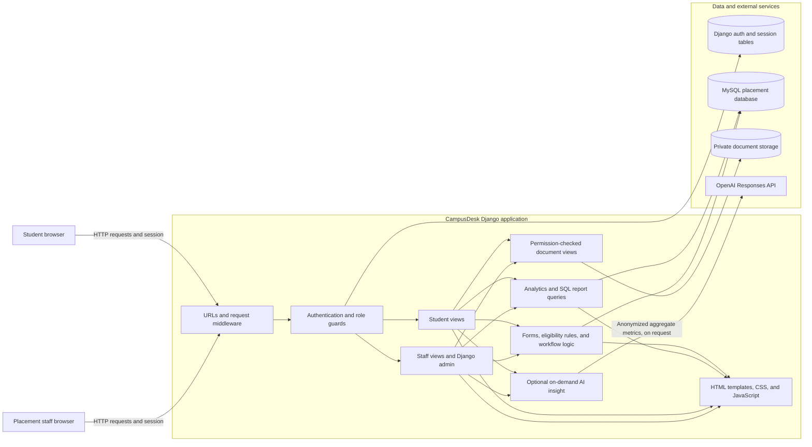

# System Architecture

CampusDesk is a server-rendered Django monolith backed by MySQL. Staff and students use separate browser entry points and role checks in the same application. Django templates render the pages; the current application does not expose a separate REST API.

## Component diagram

## Request and access flow

1. A browser request enters through Django's URL routing and security, session, CSRF, authentication, and message middleware.
2. Staff use Django staff authentication. Staff-only views require a staff account; the Django admin is available at `/admin/`.
3. Students use the student sign-in flow. `StudentPortalAccount` maps a Django user to one existing student record. The student guard resolves that mapping for each protected student page and scopes data to the linked student.
4. Views validate form input and apply the placement rules before changing records. Eligibility reasons are computed from recorded academic data, drive criteria, and configured skill requirements.
5. Django renders the resulting page with templates and static assets. Page interactions are ordinary server requests; no frontend API service is required.

## Data ownership

The database has two ownership boundaries:

- **Existing placement schema:** departments, students, skills, companies, job roles, placement drives, company drives, applications, interview rounds, selections, and offers. The SQL schema in `database/college_placement_management_db.sql` creates these tables. Their Django models are unmanaged so Django migrations do not create or alter them.
- **Application-managed additions:** student portal account mappings, semester performance, role skill requirements, interview category scorecards, reminders, offer response deadlines, status history, and private student documents. Django migrations manage these tables.

The report page loads the SELECT statements from `database/queriesdb.sql`. Operational analytics also use Django ORM queries over the placement and application-managed tables.

## Sensitive data boundaries

- Database credentials, the Django secret key, and the optional AI key are read from local environment configuration; `.env` is excluded from Git.
- Student documents are stored under `PRIVATE_MEDIA_ROOT`, outside public static URLs. Downloads pass through an authenticated view that checks staff access or ownership by the signed-in student.
- AI insight generation is optional and runs only after a user requests it. The payload contains aggregate academic, placement, and interview metrics; it excludes direct identifiers, documents, and free-text feedback. Requests use `store=false`. AI output is coaching guidance and does not make or predict hiring decisions.
- Production deployments need HTTPS, secure environment variables, protected MySQL and file storage, configured email delivery, and tested backup and restore procedures.

## Runtime configuration

`config/settings.py` loads `.env` for local development, configures MySQL, Django authentication and sessions, static assets, private file storage, email, and production security settings. `config/urls.py` connects Django admin and the placement application routes. `placements/` contains the domain models, forms, views, eligibility logic, report loading, and workflows.
