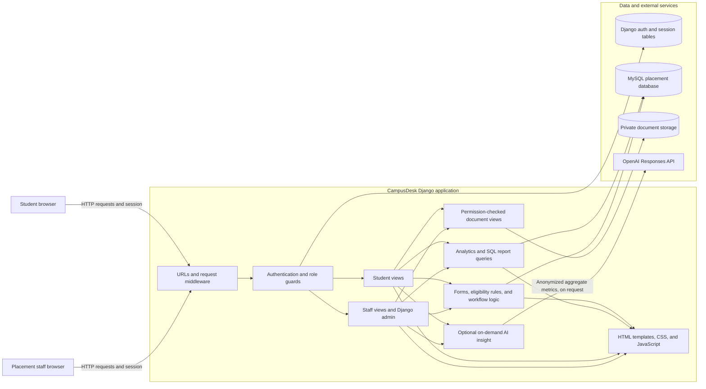

# CampusDesk — College Placement Portal

Django + MySQL placement management for a college placement office and its students. The application uses the SQL schema in `database/college_placement_management_db.sql` and its report bank in `database/queriesdb.sql`. Existing placement tables remain mapped as unmanaged Django models; the new feature tables are created by Django migrations.

## Architecture

CampusDesk is a server-rendered Django application backed by MySQL. Django handles routing, session authentication, validation, placement workflows, reporting, and HTML rendering. The current browser-based application does not expose a separate REST API.

### Component diagram



### Request and access flow

1. Browser requests pass through Django URL routing and security, session, CSRF, authentication, and message middleware.
2. Staff use Django staff authentication. Staff-only pages require a staff account; Django admin is available at `/admin/`.
3. Students use the student sign-in flow. `StudentPortalAccount` maps a Django user to one existing student record. The student access guard scopes protected pages to that linked student.
4. Views validate form input and apply placement rules before changing records. Eligibility reasons use academic data, drive criteria, and configured skill requirements.
5. Django renders pages with templates and static assets. Page interactions use server requests; there is no separate frontend API service.

### Data ownership

- **Existing placement schema:** departments, students, skills, companies, job roles, placement drives, company drives, applications, interview rounds, selections, and offers. `database/college_placement_management_db.sql` creates these tables. Their Django models are unmanaged, so Django migrations do not create or alter them.
- **Application-managed additions:** student portal account mappings, semester performance, role skill requirements, interview scorecards, reminders, offer response deadlines, status history, and private student documents. Django migrations manage these tables.

The SQL reports load SELECT statements from `database/queriesdb.sql`. Operational analytics also use Django ORM queries.

### Sensitive data boundaries

- Database credentials, the Django secret key, and the optional AI key come from local environment configuration. `.env` is excluded from Git.
- Student documents are stored under `PRIVATE_MEDIA_ROOT`, outside public static URLs. Downloads use an authenticated view that checks staff access or student ownership.
- AI insight generation runs only when requested. Its payload contains aggregate academic, placement, and interview metrics, excluding direct identifiers, documents, and free-text feedback. Requests use `store=false`; AI output is coaching guidance, not a hiring decision or prediction.

### Project structure

- `config/` — Django settings and project-level routes.
- `placements/` — data models, staff and student workflows, eligibility rules, analytics, and admin configuration.
- `templates/` and `static/` — server-rendered pages, styles, and password visibility controls.
- `database/` — the existing MySQL schema and SQL report queries.
- Django migrations — application-managed feature tables, kept separate from the existing unmanaged placement tables.

## Current capabilities

- Separate staff and student sign-in, private student dashboards, and student-scoped access.
- Staff directory, company, role, placement drive, application, interview, selection, offer, and analytics pages.
- Student application submission and status tracking; multi-offer history.
- Eligibility checks that show specific academic, department, graduation-year, and configured role-skill criteria, plus next steps.
- Semester SGPA, cumulative CGPA, and backlog history with an academic progress chart.
- Interview scorecards for technical skills, communication, problem solving, role knowledge, and teamwork. Staff choose which category feedback is released to the student.
- In-portal reminders for upcoming interviews, registration deadlines, offer response dates, and staff-created actions.
- Staff follow-up queue for upcoming interviews and incomplete student profiles.
- Validated student CSV import/export, duplicate checks, department/graduation-year filters, and status-change history.
- Protected resume/document uploads stored outside public static/media URLs and served only to placement staff or the owning student.
- Student-only password reset flow, password change, and staff controls to disable/re-enable a student account while preserving their history.
- Optional on-demand OpenAI coaching insight. It sends anonymized numeric/aggregate metrics only after the student or staff member clicks the action. It does not send student name, roll number, email, resume, or free-text interview feedback. Requests set `store=false`; standard API abuse-monitoring retention may still apply. See the [Responses API guide](https://developers.openai.com/api/docs/guides/text?lang=python) and [API data controls](https://developers.openai.com/api/docs/guides/your-data).

AI results are coaching suggestions, not hiring recommendations, candidate scores, or predictions. Staff retain responsibility for placement decisions.

## 1. Prepare MySQL

Start MySQL 8.0+ and run `database/college_placement_management_db.sql` in MySQL Workbench or the MySQL command-line client. It creates/selects `college_placement_db` and does not seed demo records or drop existing tables.

Add departments and skills before adding students and role requirements. Keep the provided `college_placement_management_db.sql` and `queriesdb.sql` files in the `database` folder.

## 2. Install and configure

In PowerShell, open a terminal in the project folder and run:

```powershell
py -m venv .venv
.\.venv\Scripts\Activate.ps1
python -m pip install --upgrade pip
python -m pip install -r requirements.txt
```

Create your local configuration from the example, then edit `.env` with your MySQL values and a unique Django secret key:

```powershell
Copy-Item .env.example .env
```

Keep `.env` private and out of source control.

The local password-reset email backend prints reset links in the terminal running the app. Configure SMTP environment variables before relying on email reset in a deployment.

AI is optional. To enable it, set `OPENAI_API_KEY` in `.env`. The default model is `gpt-5-mini`; set `OPENAI_MODEL` to a model enabled for your API account. No AI request runs automatically.

## 3. Apply migrations and start the portal

```powershell
python manage.py migrate
python manage.py createsuperuser
python manage.py runserver
```

### Local development links

These links work only on this computer while `runserver` is running. `127.0.0.1` is a loopback address; it is not a public website and will not work for a recruiter opening it from another computer.

- Staff portal: http://127.0.0.1:8000/
- Django admin: http://127.0.0.1:8000/admin/
- Student sign-in: http://127.0.0.1:8000/student/login/

To share the portal, deploy it and use the HTTPS domain assigned to the live deployment. See [DEPLOYMENT.md](DEPLOYMENT.md) before sharing a recruiter link.

The migration adds new Django-owned tables for semester results, role skill requirements, interview scorecards, reminders, offer response deadlines, audit entries, and private student documents. It does not create, drop, or alter the existing unmanaged placement tables.

## Staff workflows

1. Add verified students, companies, job roles, and placement drives.
2. Open **Job roles → Manage role skill criteria** in Django admin to configure required skill names and proficiency levels. Readiness checks compare those requirements to records in `student_skills`.
3. Add a student's term record from their performance page. The newest term record updates the student's current CGPA/backlog snapshot used by the existing eligibility rules.
4. Record an interview round, then choose **Scorecard** in Interview rounds to add categorized feedback and choose whether students can see each category.
5. Add an offer response deadline through Django admin under **Offer response deadlines**. Add a manual portal reminder from the staff dashboard when a student needs a follow-up.
6. Use **Students → CSV import / export**. Download its template first. Imports only create new students; the full import is rejected if a row is invalid or duplicates a roll number, email, or registration number.
7. Review **Status history** to see changes made through the portal and Django admin. Django admin also retains its own user action log.
8. To graduate a student, disable their portal account from the staff profile. This blocks sign-in without deleting the student or placement history. Re-enable it only when appropriate.

## Backups and production configuration

Create a compressed database backup with:

```powershell
python manage.py backup_mysql
```

The command requires the MySQL client tool `mysqldump` on PATH. It writes a timestamped `.sql.gz` file under `BACKUP_DIR` (default `backups/`). Store backups on a protected volume, set a retention schedule, and periodically test restore procedures. Do not store backups in a public web directory.

For production, set `DJANGO_DEBUG=False`, a random `DJANGO_SECRET_KEY` of at least 50 characters, the exact `ALLOWED_HOSTS`, HTTPS, and production SMTP. Secure cookies, HTTPS redirect, HSTS, and Django security headers are enabled when debug is off. If HTTPS terminates at a trusted hosting proxy, set `TRUST_PROXY_SSL_HEADER=True` only when that proxy overwrites `X-Forwarded-Proto`. Resume files are kept in `PRIVATE_MEDIA_ROOT`, which is not mapped to a public URL; use a private, backed-up disk with least-privilege access.

See [DEPLOYMENT.md](DEPLOYMENT.md) for the hosting steps, production environment variables, and the public URLs to share after deployment.

Before importing real student information, set access policies for staff accounts, secure the host and database, schedule backups, confirm SMTP delivery, and review data retention and institutional privacy rules.
